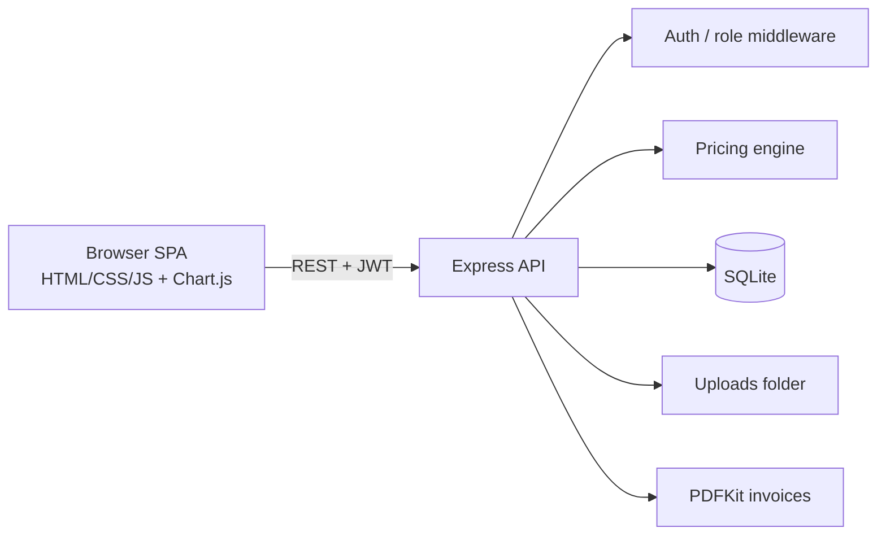

# Grand Horizon: Hotel Management & Room Booking System

Full-stack capstone: guests search and book rooms, receptionists run check-in/check-out, admins manage the whole hotel.

**Live URL:** _add after deployment_ · **Repo:** _add your GitHub link_

## Features
| Role | Can do |
|---|---|
| Guest | Search by dates/type/price/capacity (only free rooms shown), book with services and discount code, modify or cancel own bookings, download PDF invoice after the stay, leave a 1-5 star review |
| Receptionist | Walk-in bookings, check-in, check-out, cancel, update room status (Available / Cleaning / Maintenance) |
| Admin | CRUD rooms (multi-image upload with preview), services, guests, receptionists, price rules and discount codes; analytics with 3 charts and a date-range filter |

**Business rules:** no double booking (overlap check inside a DB transaction), past dates and check-out ≤ check-in rejected, price = nights × nightly rate + services − discount + tax, room status computed live (Available / Booked / Occupied / Cleaning / Maintenance), cancelling frees the dates.

**Bonus features implemented:** (1) Reviews and ratings (completed stays only, average shown on cards and details page), (2) Seasonal and dynamic pricing (weekend rule, peak-season rule, discount codes; each night priced separately).

## Tech stack
Node.js + Express, SQLite (Node built-in `node:sqlite`, no native build needed), JWT + bcrypt, Multer (uploads), PDFKit (invoices), vanilla JS single-page frontend, Chart.js. Jest + Supertest for tests, Playwright for E2E.

## Architecture

The frontend and `public/js/validators.js` are shared: the **same validation file** runs in the browser and on the server, so client and server rules always match.

## Setup
**Requires Node.js 22.13 or newer.**
```bash
git clone <your-repo-url> && cd hotel-management-system
npm install
cp .env.example .env        # set JWT_SECRET
npm start                   # http://localhost:3000
```
Demo logins (seeded): `admin@hotel.com / Admin@123`, `reception@hotel.com / Reception@123`. Guests sign up from the login page.

## Tests
```bash
npm test                    # 18 backend + unit tests (Jest + Supertest), includes overlap rejection
npx playwright install chromium
npm run test:e2e            # full booking flow: signup → search → book → check-in/out → invoice
```

## Deployment (Render, one service)
1. Push to GitHub. Set env `NODE_VERSION=22` on Render. On Render create a **Web Service** from the repo: build `npm install`, start `npm start`.
2. Environment variables: `JWT_SECRET`, `TAX_RATE`, `HOTEL_NAME`, `ADMIN_PASSWORD`.
3. Add a persistent disk (e.g. mount `/var/data`) and set `DB_PATH=/var/data/hotel.db`; uploaded images are also stored under `uploads/`, so mount a disk or use cloud storage for production.
4. To host the frontend separately (Netlify/Vercel), upload `public/`, set `window.API_URL` in `public/js/config.js`, and set `CLIENT_ORIGIN` on the API.

## Lighthouse
Run Chrome DevTools → Lighthouse on the live URL. Fix at least 3 issues and record before/after here (ideas already prepared in code: `lang` attribute, meta description, preconnect for fonts, `alt` on previews, visible focus, skip link, `viewport` meta; typical remaining ones: image dimensions, caching headers, compression).

## Screenshots
Add images to a `screenshots/` folder: search page, booking summary, reception panel, admin analytics.

## API overview
`/api/auth/*`, `/api/rooms`, `/api/services`, `/api/quote`, `/api/bookings` (+ `/cancel`, `/checkin`, `/checkout`, `/invoice`), `/api/guests`, `/api/staff`, `/api/reviews`, `/api/pricing/{rules,codes}`, `/api/admin/analytics`.
